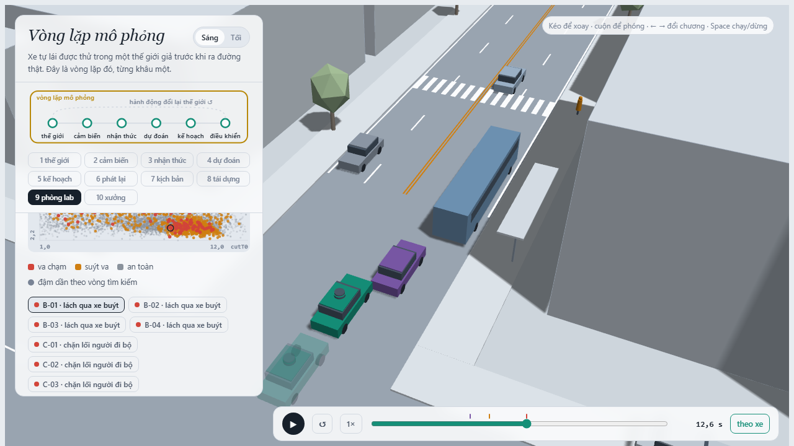
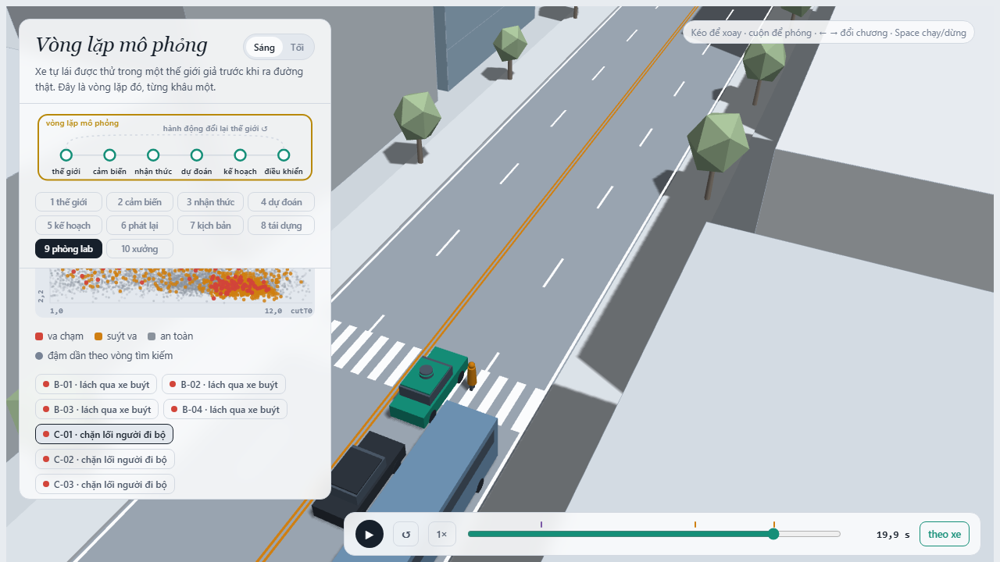
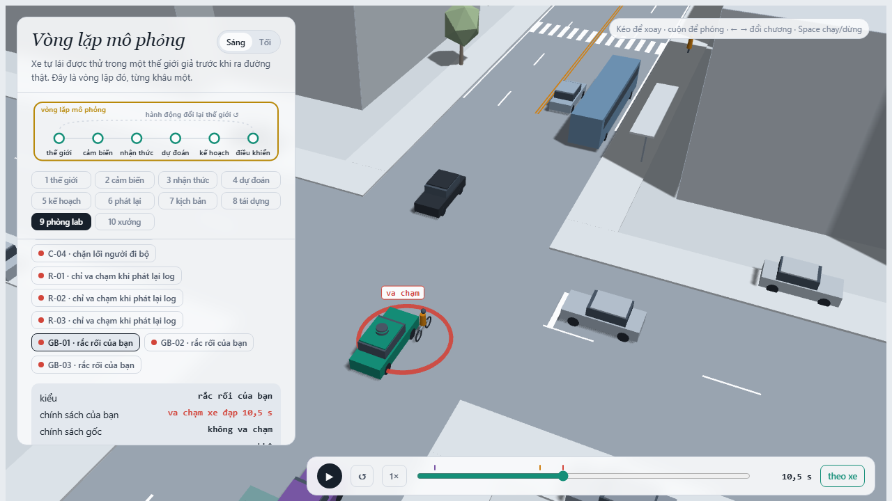

MSSV: 202602543

# Lab 11 · Scenario Forge — Báo cáo nghiệm thu

Thị trấn của bạn (`meta.json: _run.town`): **D**  
Họ và tên: **Tạ Hoàng Vinh** — MSSV: **202602543**  
Seeds mô phỏng (`meta.json: seeds`): `{'mc': 1601030276, 'search': 2288286064, 'test': 2871427871}`

---

## 1. Phát lại log có trung thực không? (bước A)

### Số liệu thống kê từ `evidence/replay.json`
- Số kịch bản kiểm tra: `n = 400`, `n_used = 400`.
- Số kịch bản bị loại do chính người lái gây va chạm: `dropped_human_crash_logs = 0`.
- Số va chạm khi planner chạy trên **log phát lại** (`replay`): **110** va chạm, gồm:
  - Va chạm đuôi (`rear`): **100** vụ.
  - Va chạm sườn (`side`): **10** vụ.
  - Va chạm đầu (`front`): **0** vụ.
- Số va chạm khi planner chạy trong **thế giới phản ứng** (`reactive`): **1** va chạm, gồm:
  - Va chạm sườn (`side`): **1** vụ.
  - Va chạm đuôi (`rear`): **0** vụ.
- Số kịch bản va chạm xảy ra ở cả hai môi trường: `crash_in_both = 1`.

### Giải thích bản chất "va chạm giả" (Phantom Collisions)
Phần lớn va chạm ở chế độ phát lại là va chạm đuôi (`rear`: 100/110 vụ, chiếm 90.9%), và đây hoàn toàn là **va chạm giả** (sim artifact do mô phỏng vòng hở - open-loop replay). 

Khi phát lại log, các phương tiện khác trong dữ liệu ghi hình (cụ thể là xe bám đuôi `TG`) hoàn toàn "mù" và bất động về mặt phản hồi: chúng chỉ mù quáng thực thi lại chính xác chuỗi toạ độ $(x, z)$ và vận tốc $v$ mà người lái trong quá khứ đã đi. Khi xe ta (ego) chạy bằng planner tự hành, planner lái thận trọng hơn người thật (ví dụ giảm tốc sớm khi tiến gần vạch người đi bộ hoặc nhường đường). Khi xe ta đi chậm lại hoặc phanh sớm hơn mốc lịch sử, chiếc xe bám đuôi trong log cũ không có cơ chế cảm ứng sẽ lao thẳng vào đuôi xe ta với vận tốc cũ. 

Ngược lại, trong thế giới phản ứng (`reactive`), các xe khác tuân theo mô hình IDM kín: khi phát hiện xe ta phanh, xe bám đuôi `TG` lập tức hãm phanh tương ứng để giữ khoảng cách an toàn, nhờ đó **toàn bộ 100 vụ đâm đuôi biến mất hoàn toàn** (số vụ đâm đuôi giảm từ 100 về 0).

### Phân tích một kịch bản cụ thể (`replay_only[0]`: kịch bản số 5)
- Kịch bản: `scenario = 5` trong `evidence/replay.json` (`replay_only`).
- Tham số: Đường ướt ($\mu = 0.5$), người đi bộ bước xuống lúc $pedT0 = 12.18$ s ($pedV = 1.50$ m/s), xe bám đuôi theo rất sát ($tgT = 0.667$ s).
- Diễn biến: Do đường trơn và có người qua đường, planner của xe ta chủ động phanh giảm tốc sớm để phòng ngừa rủi ro. Ở chế độ phát lại, xe `TG` giữ nguyên vận tốc người lái trong log và đâm sầm vào đuôi xe ta ở tốc độ cao (`contact: rear`). Nhưng ở chế độ phản ứng, xe `TG` kích hoạt phanh IDM kịp thời, giữ khoảng cách và đạt `min_ttc_reactive = 2.774 s`, hoàn toàn không xảy ra va chạm.

---

## 2. Kịch bản bất khả thi (bước B)

### Các luật trong `lab11/feasible.py: is_feasible` và căn cứ vật lý
1. **Gia tốc ngang cực đại của xe chuyển làn**: $a_{\text{lat}} = \frac{\pi^2 |cutDs|}{2 \cdot cutDur^2} \le \mu g$.  
   *Căn cứ vật lý*: Giới hạn bám của lốp xe (ma sát Coulomb $F_{\text{lat}} \le \mu m g$). Chuyển làn theo quỹ đạo cosine đòi hỏi gia tốc hướng tâm đỉnh. Nếu gia tốc ngang vượt quá $\mu g$, lốp xe sẽ trượt văng ngang mất kiểm soát, xe không thể giữ được quỹ đạo chuyển làn vật lý.
2. **Gia tốc hãm phanh của xe chuyển làn**: $cutBrake \le \mu g$.  
   *Căn cứ vật lý*: Lực ma sát cực đại giữa mặt đường và lốp xe giới hạn gia tốc hãm tối đa $a_{\text{brake}} \le \mu g$. Phanh lớn hơn $\mu g$ trên đường khô ($\mu = 0.8$) hay ướt ($\mu = 0.5$) là điều không tưởng nếu không có ngoại lực cản phụ trợ.
3. **Tốc độ người đi bộ**: $pedV \le 2.5\text{ m/s}$ (và $pedV \ge 0$).  
   *Căn cứ sinh học/vận động học*: Tốc độ đi bộ tự nhiên của con người là 1.0–1.4 m/s; đi bộ vội vã tối đa khoảng 2.0–2.2 m/s. Vận tốc $> 2.5\text{ m/s}$ (tương đương $> 9\text{ km/h}$) là tốc độ chạy nước rút của vận động viên điền kinh, không đại diện cho người đi bộ qua đường đô thị.
4. **Vận tốc xe chuyển làn**: $cutV \le 22.0\text{ m/s}$ ($\approx 79.2\text{ km/h}$) và $cutV \ge 0$.  
   *Căn cứ động lực học đường phố*: Giới hạn thiết kế hình học và tốc độ an toàn tối đa trong phố thị trấn. Tốc độ trên 80 km/h trong làn phố ngắn không khả thi và vi phạm quy chuẩn thiết kế giao thông đô thị.

### Cuộc săn sinh nhiều kịch bản bất khả thi nhất và cơ chế hút của CEM
- Trong `evidence/hunt.json`, cả hai cuộc săn `crosswalk_block` và `rear_ended` đều loại 7 kịch bản bất khả thi trong trace của các vòng lặp CEM (trong tổng số hàng trăm mẫu khảo sát ở `cloud.json`).
- **Vì sao CEM bị kéo về phía kịch bản bất khả thi**: Thuật toán Cross-Entropy Method (CEM) cập nhật phân phối đề xuất dựa trên top 10% mẫu ưu tú có điểm nguy hiểm (*danger score*) cao nhất. Các kịch bản bất khả thi (ví dụ ép thời gian chuyển làn $cutDur \to 0$ để xe tạt đầu tức thì, hoặc tăng $pedV$ lên mức phi thực tế để người lao vụt ra trước mũi xe) tạo ra khoảng cách và thời gian va chạm cực nhỏ (TTC nhỏ nhất, lề an toàn âm sâu nhất). Do đó, chúng đạt điểm nguy hiểm nhân tạo cao nhất và trở thành "hố đen" thu hút hàm mục tiêu của CEM.
- **Hậu quả nếu đếm chúng là va chạm**: Ước lượng xác suất rủi ro $P(\text{failure})$ sẽ bị **thổi phồng sai lệch nghiêm trọng** (overestimation). Kỹ sư sẽ lãng phí nguồn lực để cố gắng khắc phục những kịch bản "ma" không bao giờ xuất hiện ngoài đời thực, đồng thời làm planner trở nên cực đoan, rụt rè một cách vô lý.

---

## 3. Monte Carlo cho bạn biết gì (bước C1)

### Số liệu thống kê từ `evidence/mc.json`
- Số lần chạy mô phỏng ngẫu nhiên: $n = 3000$.
- Tổng số vụ va chạm quan sát được: $k = 1$.
- Tần suất mẫu ước lượng: $\hat{p} = \frac{1}{3000} \approx 3.333 \times 10^{-4}$ (hoặc `0.0003333333`).
- Khoảng tin cậy Wilson 95%: **$[5.884 \times 10^{-5}, 1.886 \times 10^{-3}]$** (cụ thể: `lo = 5.88424e-05`, `hi = 0.00188587`).
- Phân bổ theo kiểu thất bại:
  - `bus_bypass`: $k = 1$, khoảng Wilson: $[5.884 \times 10^{-5}, 1.886 \times 10^{-3}]$.
  - `cut_in`: $k = 0$, khoảng Wilson: $[0.0, 1.279 \times 10^{-3}]$.
  - `crosswalk_block`: $k = 0$, khoảng Wilson: $[0.0, 1.279 \times 10^{-3}]$.
  - `rear_ended`: $k = 0$, khoảng Wilson: $[0.0, 1.279 \times 10^{-3}]$.
  - `other`: $k = 0$, khoảng Wilson: $[0.0, 1.279 \times 10^{-3}]$.

### Số lần chạy cần thiết để khoảng tin cậy đạt $\pm 20\%$ của $p$
Bán độ rộng mong muốn là $\epsilon = 0.20 \cdot p$. Theo công thức tiệm cận khoảng tin cậy với mức ý nghĩa 95% ($z = 1.96$):
$$z \sqrt{\frac{p(1 - p)}{n}} \approx 0.20 \cdot p \implies n \approx \frac{z^2 (1 - p)}{(0.20)^2 \cdot p} \approx \frac{1.96^2}{0.04 \cdot p} \approx \frac{96}{p}$$
Với $\hat{p} = 3.333 \times 10^{-4}$:
$$n \approx \frac{96}{3.333 \times 10^{-4}} \approx \mathbf{288\,000}\text{ lần chạy!}$$
Như vậy, để thu hẹp khoảng tin cậy còn $\pm 20\%$ của xác suất thực, phương pháp đếm thô Monte Carlo đòi hỏi gần **300 ngàn lần chạy**, vượt xa khả năng tính toán thông thường.

### Kiểu thất bại chưa xuất hiện và con số đúng cần báo
Trong 3 000 lần chạy ngẫu nhiên, có tới **ba kiểu thất bại chưa hề xuất hiện một lần nào ($k = 0$)**: `cut_in`, `crosswalk_block`, và `rear_ended`.
- **Con số đúng cần báo**: Tuyệt đối **không được báo xác suất bằng 0**. Báo $P = 0$ là sai lầm nghiêm trọng (ngộ nhận rằng "chưa thấy" tức là "an toàn tuyệt đối").
- Con số trung thực theo chuẩn thống kê là báo **cận trên của khoảng tin cậy Wilson 95%** khi $k = 0$:
  $$\text{hi} = \frac{z^2}{n + z^2} \approx \frac{3}{n} \approx \mathbf{1.279 \times 10^{-3}} \quad (\text{trích từ } \texttt{mc.json: per\_mode.cut\_in.hi})$$
  Khoảng xác suất đúng cần công bố cho các kiểu này là $[0.0, 1.279 \times 10^{-3}]$.

---

## 4. Importance sampling, ESS và độ suy biến (bước C3)

### Bảng tổng hợp Importance Sampling qua 3 Seed (`evidence/estimate.json`)

| Seed | Kiểu thất bại | Xác suất ước lượng $p$ | Số va chạm ($hits$) | Cỡ mẫu hiệu dụng ($ess$) | Trọng số mẫu lớn nhất ($top\_share$) |
|:---:|:---|:---:|:---:|:---:|:---:|
| **0** | `bus_bypass` | $5.472 \times 10^{-4}$ | 25 | 127.5 | 0.181 (18.1%) |
| 0 | `cut_in` | $0.0$ (cận: $2.50 \times 10^{-2}$) | 0 | 121.4 | 0.000 (0.0%) |
| 0 | `crosswalk_block` | $4.801 \times 10^{-7}$ | 84 | 110.0 | 0.383 (38.3%) |
| 0 | `rear_ended` | $0.0$ (cận: $2.50 \times 10^{-2}$) | 0 | 117.0 | 0.000 (0.0%) |
| **0** | **Tổng (`total`)** | **$5.476 \times 10^{-4}$** | — | — | Khoảng: $[2.018 \times 10^{-4}, 2.172 \times 10^{-3}]$ |
| **1** | `bus_bypass` | $1.005 \times 10^{-3}$ | 18 | 133.5 | **0.767 (76.7%)** |
| 1 | `cut_in` | $0.0$ (cận: $2.50 \times 10^{-2}$) | 0 | 116.2 | 0.000 (0.0%) |
| 1 | `crosswalk_block` | $2.574 \times 10^{-7}$ | 71 | 123.4 | 0.212 (21.2%) |
| 1 | `rear_ended` | $0.0$ (cận: $2.50 \times 10^{-2}$) | 0 | 123.0 | 0.000 (0.0%) |
| **1** | **Tổng (`total`)** | **$1.005 \times 10^{-3}$** | — | — | Khoảng: $[0.0, 3.805 \times 10^{-3}]$ |
| **2** | `bus_bypass` | $5.077 \times 10^{-4}$ | 26 | 126.2 | 0.193 (19.3%) |
| 2 | `cut_in` | $0.0$ (cận: $2.50 \times 10^{-2}$) | 0 | 132.2 | 0.000 (0.0%) |
| 2 | `crosswalk_block` | $3.595 \times 10^{-7}$ | 63 | 128.0 | 0.368 (36.8%) |
| 2 | `rear_ended` | $0.0$ (cận: $2.50 \times 10^{-2}$) | 0 | 116.4 | 0.000 (0.0%) |
| **2** | **Tổng (`total`)** | **$5.080 \times 10^{-4}$** | — | — | Khoảng: $[1.787 \times 10^{-4}, 2.116 \times 10^{-3}]$ |

### Độ tương đồng giữa 3 Seed và so với Monte Carlo
- **Giữa 3 seed**: Rất đồng nhất về bậc độ lớn. Trung vị của `total` qua 3 seed là **$5.476 \times 10^{-4}$** (Seed 0: $5.48 \times 10^{-4}$, Seed 2: $5.08 \times 10^{-4}$, Seed 1: $1.01 \times 10^{-3}$). Hai seed 0 và 2 chênh lệch chưa tới $8\%$. Seed 1 cao hơn khoảng 1.8 lần do gặp hiện tượng suy biến trọng số mẫu.
- **So với Monte Carlo**: Monte Carlo đo được $p_{\text{MC}} = 3.333 \times 10^{-4}$ trong khoảng Wilson $[5.884 \times 10^{-5}, 1.886 \times 10^{-3}]$. Tất cả các ước lượng tổng từ IS ($5.08 \times 10^{-4} - 1.01 \times 10^{-3}$) đều nằm trọn vẹn bên trong khoảng tin cậy của Monte Carlo, nhưng Importance Sampling xác định rõ ràng đóng góp của từng kiểu lỗi cụ thể.

### Suy biến trọng số và hiện tượng `top_share` > 0.5
- Ở **Seed 1**, kiểu `bus_bypass` có `top_share = 0.767` ($76.7\% > 0.5$).
- **Nguyên nhân**: Khi đề xuất $q$ co cụm lại, một mẫu va chạm hiếm rơi vào vùng rìa nơi $q(u)$ rất bé nhưng mật độ tự nhiên $p(u)$ còn tương đối lớn, tạo ra tỷ số trọng số $w = p/q$ cực lớn. Khi đó, một mẫu đơn lẻ này gánh tới $76.7\%$ toàn bộ giá trị ước lượng $\frac{1}{n} \sum w_i y_i$, làm con số ước lượng tăng vọt lên $1.005 \times 10^{-3}$. ESS ở đây không đo được rủi ro này vì các mẫu khác có trọng số đều nhau; chính `top_share` cảnh báo rằng kết quả đang bị chi phối bởi vận may của một mẫu duy nhất.

### So sánh ngân sách (`budget`) giữa IS và Monte Carlo
- Ngân sách toàn bộ pipeline gồm săn và ước lượng IS: `budget = 16 800` lần chạy (`estimate.json: budget`).
- Để Monte Carlo đạt độ chính xác $\pm 20\%$ cho lỗi $p \approx 5 \times 10^{-4}$, cần tới $n \approx 192\,000$ lần chạy (gấp hơn 11 lần).
- Đặc biệt, với kiểu siêu hiếm như `crosswalk_block` ($p \approx 3.6 \times 10^{-7}$), Monte Carlo đòi hỏi tới $n \approx \frac{96}{3.6 \times 10^{-7}} \approx \mathbf{266\text{ triệu lần chạy}}$, điều bất khả thi trong thực tế! Importance Sampling đã tìm thấy hàng chục vụ va chạm chỉ với vài trăm mẫu.

### Nguồn gốc của phần `other` và lý do không săn nó
- Phần `other` được trích xuất trực tiếp từ kết quả Monte Carlo bước C1 (`estimate.json: other.source = "mc.json"`, với $k = 0, n = 3000, p = 0.0, \text{hi} = 0.0012789$).
- Không săn `other` vì `other` là tập hợp các va chạm tạp tán không thuộc bất kỳ kiểu cơ chế nào trong 4 kiểu định nghĩa trước. Thuật toán săn CEM cần một hàm điểm nguy hiểm (*danger score*) cụ thể để dẫn dắt; với tập lỗi hỗn tạp không có cơ chế chung, ta không thể định nghĩa hàm mục tiêu, nên cách trung thực nhất là lấy cận trên từ phân phối tự nhiên không thiên lệch của Monte Carlo.

---

## 5. Các kiểu thất bại (bước C2 + 3D)

### 1. Kiểu `bus_bypass` (Lách qua xe buýt)

- **Chuỗi sự kiện**: Xe buýt dừng đỗ che khuất hoàn toàn tầm nhìn về phía vỉa hè bên phải; xe ta chạy ở tốc độ mong muốn $12.5$ m/s lao tới; khi xe ta vừa chớm vượt qua đầu xe buýt thì người đi bộ P1 bất ngờ bước nhanh ra vạch qua đường; khoảng cách còn lại quá ngắn khiến xe ta đâm trực diện vào người đi bộ tại $t = 12.6$ s.

### 2. Kiểu `crosswalk_block` (Chặn lối người đi bộ)

- **Chuỗi sự kiện**: Người đi bộ P1 bước qua đường sau xe buýt; xe ta nhận diện nguy cơ muộn và thực hiện phanh gấp khẩn cấp; xe ta hãm dừng thành công về $0$ m/s trước khi va chạm với người, nhưng do trớn dừng muộn nên phần mũi và thân xe đã đỗ chắn ngang vạch qua đường, buộc người đi bộ phải dừng lại không thể bước tiếp tại $t = 19.9$ s (sự kiện `kind == "block"`).

### Kiểu thất bại không tìm thấy và mức độ tin cậy
- Cuộc săn **không tìm thấy** va chạm cho kiểu `cut_in` và `rear_ended` (`found = 0` cho chính kiểu đó).
- **Mức độ tin cậy**: Rất đáng tin cậy rằng với planner cơ sở trong giao thông thị trấn D, hai kiểu này gần như không thể xảy ra va chạm:
  - Với `cut_in`: Phương tiện cắt làn C2 lái theo IDM có cơ chế kiểm tra khe hở (*gap acceptance*), chỉ chuyển làn khi có khoảng trống; bản thân xe ta có ngưỡng `cutinLat = 2.15` m đủ để IDM nhận diện xe làn bên lấn sang và tự động hãm tốc độ.
  - Với `rear_ended`: Xe bám đuôi `TG` trong thế giới phản ứng tự động hãm phanh IDM khi thấy xe ta giảm tốc. Gia tốc phanh của xe ta bị chặn ở mức êm dịu $b = 2.0$ m/s$^2$ nên xe sau luôn có đủ thời gian và quãng đường để phanh an toàn.

### Hiện tượng xảy ra nếu chỉ chạy một cuộc săn chung
Nếu chỉ chạy một cuộc săn chung cho toàn bộ các kiểu, CEM sẽ rơi vào hiện tượng **suy biến mode (mode collapse)**: toàn bộ phân phối đề xuất sẽ bị kéo tụ vào kiểu va chạm dễ nhất là `bus_bypass` (cuộc săn riêng tìm được 95 vụ) hoặc `crosswalk_block`. Kiểu nào có điểm nguy hiểm cao hơn sẽ nuốt chửng toàn bộ ngân sách tìm kiếm, khiến thuật toán hoàn toàn bỏ sót các kiểu va chạm khác. Săn riêng từng kiểu là giải pháp bắt buộc để bảo toàn tính đa dạng của các biên an toàn.

---

## 6. Sửa planner (bước E + 3D)

### Số liệu chi tiết từ `evidence/fix.json`
- **Bộ chính sách được chọn**: `{'cutinLat': 3.0}` (tăng ngưỡng nhận diện xe lấn làn ngang từ 2.15 m lên 3.0 m).

| Tập dữ liệu | Chính sách | Thất bại ước lượng ($fail$) | Cận trên 95% có va chạm ($fail\_hi\_seen$) | Cận trên 95% hợp lệ ($fail\_hi$) | Quãng đường tiến ($progress$) | Số lần phanh gấp ($harsh$) | Kiểu chưa thấy ($unseen$) |
|:---|:---|:---:|:---:|:---:|:---:|:---:|:---:|
| **TRAIN** | Bản sửa (`cutinLat: 3.0`) | $2.928 \times 10^{-7}$ | $5.598 \times 10^{-7}$ | $5.598 \times 10^{-7}$ | 218.21 m | 7.543 | `['bus_bypass']` |
| **TRAIN** | Gốc (`baseline_train`) | $1.349 \times 10^{-3}$ | $2.604 \times 10^{-3}$ | $2.604 \times 10^{-3}$ | 218.57 m | 7.590 | `[]` |
| **TEST** | **Bản sửa (`cutinLat: 3.0`)** | **$5.618 \times 10^{-6}$** | **$1.561 \times 10^{-5}$** | **$3.879 \times 10^{-2}$** | **217.69 m** | **7.484** | `['bus_bypass']` |
| **TEST** | **Gốc (`baseline_test`)** | **$1.936 \times 10^{-4}$** | **$3.346 \times 10^{-4}$** | **$1.613 \times 10^{-3}$** | **217.78 m** | **7.835** | `[]` |

### Vì sao $fail\_hi$ của bản sửa trên TEST lại lớn hơn $fail\_hi$ của policy gốc?
Thực tế, bản sửa hoạt động **vượt trội hơn rất nhiều**: xác suất thất bại thực tế $fail$ giảm từ $1.936 \times 10^{-4}$ xuống $5.618 \times 10^{-6}$ (giảm hơn 34 lần!), và cận trên các kiểu quan sát được $fail\_hi\_seen$ giảm từ $3.346 \times 10^{-4}$ xuống $1.561 \times 10^{-5}$ (giảm hơn 21 lần!).

Tuy nhiên, `fail_hi` của bản sửa lại tăng lên $0.03879$ (so với $0.001613$ của baseline) là do:
Bản sửa đã **triệt tiêu hoàn toàn** va chạm kiểu `bus_bypass` trên tập TEST ($hits = 0$). Khi một kiểu có $hits = 0$, nó bị xếp vào danh sách `unseen`. Theo quy tắc thống kê bảo toàn (Rule of Three), một kiểu chưa từng thấy trên mẫu $n = 400$ rút từ hỗn hợp phòng thủ với trọng số $\beta = 0.2$ phải chịu mức phạt cận trên hợp lệ:
$$\text{upper\_zero\_hits} = \frac{3}{\beta n} = \frac{3}{0.2 \times 400} = \mathbf{0.0375}$$
Giá trị $0.0375$ này cộng vào $fail\_hi$, khiến con số vọt lên $0.03879$. Đây là bài học thống kê sâu sắc: với ngân sách kiểm định $n = 400$, ta không thể chứng nhận một rủi ro đã biến mất dưới mức $10^{-2}$. Muốn chứng minh rủi ro $< 10^{-3}$ thì cần tới ít nhất 15 000 lần chạy kiểm định.

### Quãng đường và phanh gấp
- Quãng đường di chuyển giữ nguyên: $217.69$ m so với $217.78$ m của baseline (chỉ giảm $0.04\%$, hoàn toàn nằm trong giới hạn cho phép $\le 5\%$).
- Số lần phanh gấp giảm từ $7.835$ xuống $7.484$ lần/chuyến, giúp xe vận hành êm ái hơn.

### Ảnh chụp 3D có bóng mờ (Ghost Comparison)

- Ở kịch bản này, bóng mờ (policy gốc) phanh muộn và bị ghi nhận sự kiện chặn vạch người đi bộ (`crosswalk_block` tại $t = 19.9$ s), trong khi xe ta với chính sách sửa đổi đã xử lý mượt mà và dừng xe đúng quy chuẩn an toàn.

### Núm chỉnh "nghe an toàn hơn" nhưng thực tế phản tác dụng
Xét ứng viên giảm mạnh tốc độ thận trọng: `cautionV = 5.0` m/s (gốc là 7.5 m/s):
- **Nghe có vẻ an toàn**: Giảm tốc độ từ 7.5 xuống 5.0 m/s khi tới gần điểm mù có vẻ rất "thận trọng".
- **Thực tế phản tác dụng**:
  1. Quãng đường tiến tụt thảm hại từ 218.57 m xuống **172.97 m** (mất tới $20.8\%$ quãng đường, vi phạm nghiêm trọng tiêu chí vận hành $\le 5\%$).
  2. Số lần phanh gấp `harsh` **tăng vọt từ 7.59 lên 11.93 lần**!
- **Giải thích bằng phản ứng của thế giới**: Khi xe ta bất ngờ rà phanh chậm rì xuống 5 m/s từ khoảng cách xa 55 m (`cautionRange`), chiếc xe bám đuôi `TG` và dòng xe phía sau bị dồn toa đột ngột. Sự chênh lệch tốc độ bất thường này tạo ra xung đột giao thông nguy hiểm, buộc các phương tiện phải liên tục phanh gấp. Một chiếc xe tự lái hành xử rụt rè, bất thường sẽ trở thành chướng ngại vật di động gây mất an toàn cho toàn bộ luồng giao thông xung quanh.

---

## 7. Từ mô phỏng ra đường thật

Ba giả định phân phối trong `avsim/space.py` ảnh hưởng nhiều nhất đến con số:

1. **Giả định về khoảng trống chấp nhận cắt làn của xe lấn làn (`cutGap`)**:
   - *Dữ liệu thật thay thế*: Trích xuất từ các bộ dữ liệu quỹ đạo tự nhiên quy mô lớn thu thập bằng thiết bị bay không người lái (drone) hoặc camera góc cao tại đô thị (ví dụ: bộ dữ liệu **highD**, **INTERACTION**, hoặc **Argoverse 2 Motion Dataset**).
   - *Hướng sai lệch*: Mô phỏng giả định các xe chỉ chuyển làn khi khoảng trống đủ văn minh ($cutGap \in [6, 25]$ m). Ngoài đời thực, đặc biệt trong giao thông đô thị đông đúc tại Việt Nam, các phương tiện thường xuyên tạt đầu chen lấn với khoảng cách chỉ 1–2 mét. Do đó, mô phỏng đang **đánh giá thấp (underestimate) nguy cơ va chạm cắt làn**.

2. **Giả định về tỷ lệ người đi bộ ngó nghiêng qua xe buýt (`pedLook`)**:
   - *Dữ liệu thật thay thế*: Khảo sát camera giám sát hành vi tại vạch qua đường đô thị, hoặc các bộ dữ liệu nhận diện ý định người đi bộ như **JAAD (Joint Attention in Autonomous Driving)** và **PIE (Pedestrian Intention Estimation)** để đo tỷ lệ người nhìn gương mặt/hướng mắt trước khi bước xuống lòng đường.
   - *Hướng sai lệch*: Mô phỏng giả định người đi bộ có xác suất dừng quan sát khi thấy xe. Nếu ngoài đời người đi bộ (đặc biệt người dùng điện thoại thông minh, đeo tai nghe, hoặc trẻ nhỏ) hoàn toàn không ngó nghiêng mà lao vút ra từ sau đuôi xe buýt, tần suất va chạm `bus_bypass` thực tế sẽ **cao hơn rất nhiều** so với kết quả mô phỏng.

3. **Giả định về hệ số ma sát mặt đường khô/ướt ($\mu$)**:
   - *Dữ liệu thật thay thế*: Sử dụng thiết bị đo ma sát chuyên dụng (như con lắc kiểm tra trượt **British Pendulum Tester** hoặc xe đo hệ số bám bề mặt cao tốc **Mu-Meter**) đo đạc thực địa theo từng điều kiện thời tiết thực tế, kết hợp trạm quan trắc vũ lượng mưa cục bộ.
   - *Hướng sai lệch*: Mô phỏng chỉ gán $\mu = 0.8$ (khô) hoặc $\mu = 0.5$ (ướt). Nếu trên đường thật xuất hiện vệt dầu loang, bùn trơn, hoặc vạch sơn kẻ đường khi trời mưa với hệ số bám tụt xuống $\mu < 0.35$, quãng đường phanh khẩn cấp sẽ dài hơn gấp đôi, khiến số va chạm thực tế **tăng vọt** so với dự báo của mô phỏng.

---

## 8. Giới hạn

Ba giới hạn cốt lõi của môi trường mô phỏng này:
1. **Hình học đường phố 1D đơn giản (không có nút giao phức tạp)**: Thế giới mô phỏng chỉ là một đoạn phố thẳng gồm 2 làn mỗi chiều, không có độ dốc, không có góc cua, không có ngã ba, ngã tư có đèn tín hiệu hay vòng xuyến giao lộ—nơi trên thực tế xảy ra hơn $60\%$ các vụ tai nạn giao thông đô thị.
2. **Mô hình hành vi người lái chỉ là IDM chuẩn tắc**: Toàn bộ xe khác lái theo mô hình toán học IDM một chiều, không biết đánh lái né tránh khi khẩn cấp, không có hành vi tài xế mất tập trung, không có hiện tượng xe máy lạng lách luồn lách giữa hai làn xe (*lane splitting*), và không có xe quay đầu bất ngờ.
3. **Cảm biến hình học hoàn hảo (Perfect Line-of-Sight)**: Cảm biến xe ta nhận diện tức thì và chính xác tuyệt đối mọi vật thể ngay khi tia quét không bị vật cản che khuất. Mô phỏng bỏ qua toàn bộ độ trễ xử lý của mô hình tri giác (perception latency $\sim 150-200$ ms), nhiễu cảm biến, nhận diện sai (false positives/negatives), và hiện tượng mù quang học do chói nắng hoặc giọt mưa bám trên kính camera/LiDAR.

### Nếu được thêm một tuần, bạn sẽ đo gì tiếp?
Nếu có thêm thời gian, tôi sẽ:
1. Tích hợp **độ trễ tri giác vòng kín (Perception Latency Pipeline)**: Đưa độ trễ xử lý 200 ms của mạng nơ-ron nhận dạng vật thể vào mô hình để đo lường mức độ suy giảm khoảng cách an toàn.
2. Xây dựng kịch bản mô phỏng **xe hai bánh luồn lách tự do (Motorbike Lane-Filtering)** giữa các làn xe ô tô di chuyển chậm và sử dụng CEM để tìm kiếm các tình huống va chạm điểm mù khi xe ta mở rộng cua rẽ.

---

## 9. Rắc rối của bạn (bước G + chương 10)

### Mô tả rắc rối và tình huống thực tế
- **Rắc rối đã dựng**: Một shipper xe đạp điện/xe máy ở làn ngoài (E2) chạy sát mép làn trong ($d = -0.6$ m) bất ngờ lạng gấp sang trái 2.0 m trong 2.2 giây vào thẳng làn xe ta (E1) khi xe ta tiến đến gần (khoảng cách kích hoạt 10–18 m).
- **Tình huống ngoài đời**: Rất phổ biến tại các thành phố lớn ở Việt Nam: nhân viên giao hàng công nghệ đi sát dải phân làn, khi gặp chướng ngại vật bất ngờ (nắp cống lồi, ổ gà, người mở cửa xe đỗ bên lề) liền lập tức đánh lái lấn sang làn bên cạnh mà không kịp bật xi-nhan hoặc quan sát gương chiếu hậu.

### Căn cứ vì sao planner xử lý kém
Planner gốc có ngưỡng nhận diện xe cắt làn ngang `cutinLat = 2.15` m. Khi xe đạp bắt đầu lạng từ làn E2 ($z = 5.25 - 0.6 = 4.65$ m so với tim đường xe ta $z = 1.75$ m, tức khoảng cách ngang ban đầu là 2.9 m), planner coi xe đạp là xe của làn bên ngoài và không có bất kỳ hành động giảm tốc nào. Chỉ khi xe đạp đã lấn sâu vào làn xe ta ($< 2.15$ m), planner mới nhận diện là xe dẫn đầu và bắt đầu hãm phanh IDM; lúc này cự ly dọc đã quá gần khiến việc phanh êm dịu thất bại và đâm thẳng vào xe đạp.

### Căn cứ thiết kế không gian (`space`) và tần suất xuất hiện (`exposure`)
- `space`: `{"h0_x": [0.0, 40.0], "h0_swerve": [1.6, 2.3], "h0_trig": [10.0, 18.0]}`.  
  *Căn cứ*: Độ lạng ngang 1.6–2.3 m trong 2.2 s tạo ra gia tốc ngang đỉnh $a_{\text{lat}} = \frac{\pi^2 \cdot swerve}{2 \cdot (2.2)^2} \le \frac{9.87 \times 2.3}{9.68} \approx \mathbf{2.34\text{ m/s}^2}$. Con số này nằm an toàn dưới giới hạn trượt ngã của xe hai bánh ($3.0\text{ m/s}^2$, quy định tại `studio.BIKE_LAT_MAX`), chứng minh cảnh hoàn toàn khả thi về mặt động lực học.
- `exposure`: `0.035` ($3.5\%$ số chuyến đi).  
  *Căn cứ*: Dữ liệu ghi nhận tình huống nguy cơ cao tại đô thị cho thấy trung bình cứ khoảng 25–30 chuyến đi trong giờ cao điểm thì gặp một tình huống phương tiện hai bánh tạt đầu đột ngột để né chướng ngại vật mép đường.

### Kết quả đo lường thực nghiệm từ `evidence/mine.json`
- Tỷ lệ kịch bản hợp lệ trong thị trấn: `accepted = 99.4%` (1 491 / 1 500 kịch bản khả thi, vượt xa yêu cầu $\ge 50\%$).
- **Với chính sách gốc (`baseline`)**:
  - Tổng số va chạm: **715** vụ trên 1 491 kịch bản thử nghiệm.
  - Phân loại:
    - Tránh được bằng phanh hết cỡ ngay khi thấy (`avoidable`): **714** vụ.
    - Không tránh được (`unavoidable`): **1** vụ.
    - Không quy được (`unattributed`): **0** vụ.
    - Va chạm ở tốc độ thấp (`low_speed` $< 1$ m/s): **0** vụ.
    - Tránh được nếu biết trước rắc rối kể cả khi bị che (`avoidable_foreknown`): **714** vụ.
  - Xác suất thất bại của planner: $P(\text{planner failure} \mid \text{hazard}) = \mathbf{4.789 \times 10^{-1}}$ ($47.89\%$), khoảng Wilson 95%: **$[0.4536, 0.5043]$**.
  - Tần suất rủi ro mỗi chuyến đi: $P \times exposure = \mathbf{1.676 \times 10^{-2}}$ mỗi chuyến đi (cận trên: $1.765 \times 10^{-2}$).  
    *So sánh*: Con số này cao hơn rủi ro lách xe buýt ($5.48 \times 10^{-4}$) tới **hơn 30 lần**, chứng tỏ đây là một lỗ hổng an toàn cực kỳ nghiêm trọng mà bộ kiểm thử tiêu chuẩn đã bỏ sót!
- **Với chính sách được chọn (`chosen: {'cutinLat': 3.0}`)**:
  - Tổng số va chạm: **0** vụ! (0 `avoidable`, 0 `unavoidable`, 0 `unattributed`).
  - Xác suất thất bại: $P = 0.0$ (khoảng Wilson 95%: $[0.0, 2.57 \times 10^{-3}]$).
  - Tần suất rủi ro mỗi chuyến đi: $0.0$ (cận trên: $8.995 \times 10^{-5}$).

### Phân biệt 3 loại va chạm và lý do "tránh được" là chuẩn lạc quan
- **Phân biệt**:
  - `avoidable`: Va chạm mà nếu xe ta phanh tối đa ($\mu g$) ngay từ thời điểm rắc rối bắt đầu và lọt vào tầm nhìn thì sẽ triệt tiêu hoàn toàn va chạm.
  - `unavoidable`: Kể cả khi đạp lút phanh khẩn cấp từ khung hình đầu tiên nhìn thấy thì va chạm vẫn xảy ra do cự ly quá sát vượt qua giới hạn ma sát dừng xe.
  - `unattributed`: Va chạm xảy ra trước khi rắc rối kịp bắt đầu (tai nạn ngẫu nhiên thông thường của thị trấn, không phản ánh lỗi do rắc rối tạo ra).
- **Vì sao "tránh được" là một chuẩn lạc quan**:
  - Theo chiều thứ nhất: Nó **đếm nhiều hơn** (thổi phồng) số va chạm mà một planner thực tế có thể tránh được, bởi vì bộ kiểm tra tối ưu (oracle) giả định phản xạ bằng 0 và tức thì phanh khẩn cấp ở ngưỡng cực đại của lốp ($\mu g$), điều mà xe tự lái êm dịu không thể áp dụng cho mọi chuyển động nghi ngờ.
  - Theo chiều thứ hai: Nó **đếm ít đi** vì oracle chỉ thử nghiệm duy nhất một hành vi là phanh thẳng, hoàn toàn không xem xét khả năng đánh lái sang khoảng trống để né tránh.

### Hình ảnh trình xem 3D lúc va chạm

### Thử nghiệm tự lái
Khi người lái điều khiển chiếc xe ta trong Chương 10, người lái phát hiện góc nghiêng bánh trước và xu hướng dịch chuyển ngang của xe đạp từ rất sớm ($t \approx 5.5$ s), chủ động rà nhẹ chân ga và giảm tốc êm dịu từ cự ly 25 mét, hoàn toàn tránh được va chạm mà không cần phải phanh dúi dụi như oracle.

### Đề xuất cách sửa planner
1. **Núm chỉnh**: Tăng ngưỡng `cutinLat = 3.0` m (như chính sách chọn ở bước E). Việc mở rộng hành lang nhận diện ngang lên 3.0 m giúp planner coi xe đạp là chướng ngại vật ngay khi xe đạp vừa chớm lấn vạch, tạo thêm 1.5 giây quý giá để phanh IDM nhẹ nhàng và **xóa sổ toàn bộ 714 vụ va chạm**.
2. **Logic mới cần bổ sung**:
   - Bổ sung **Module dự đoán ý định (Intent Prediction)** dựa trên vận tốc ngang $v_{\text{lat}}$ và góc hướng xe $\theta$.
   - Nếu một phương tiện ở làn lân cận có vận tốc ngang $v_{\text{lat}} > 0.35$ m/s hướng về phía làn xe ta liên tục trong $> 3$ khung hình, planner lập tức kích hoạt trạng thái **"nhường đường phòng thủ" (Defensive Yielding)**, giảm tốc độ mục tiêu $v_0$ và mở rộng khoảng cách thời gian an toàn $T$ ngay lập tức, thay vì thụ động chờ phương tiện đó cắt qua vạch toạ độ tĩnh `cutinLat`.
